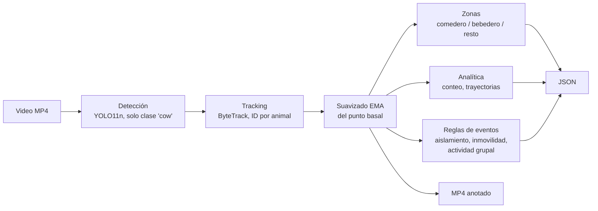

# AgroCow

Detecta y sigue bovinos en video de corral, mide cuánto tiempo pasan en el comedero y el bebedero, y marca desvíos de conducta (aislamiento, inmovilidad prolongada, cambios bruscos de actividad del grupo) para que una persona los revise.

> **Estado: prototipo temprano.** El motor corre de punta a punta sobre un video y entrega un JSON y un MP4 anotado. **No tiene evaluación de precisión todavía**: no hay dataset etiquetado ni métricas de aciertos y falsos positivos. Tampoco hay tests automatizados. Auditado sobre el commit `f6f08db` (2026-11-07).

## Qué NO es

- **No diagnostica.** Genera alertas de comportamiento para revisión veterinaria. Ninguna alerta significa "este animal está enfermo".
- **No detecta enfermedades de laboratorio** (brucelosis, tuberculosis, etc.) ni reemplaza la denuncia al SENASA. Ver [Sanidad animal y denuncia obligatoria](#sanidad-animal-y-denuncia-obligatoria).
- **No identifica a la vaca entre días.** Un animal recibe un número de seguimiento (`track_id`) dentro de un video; el número se reinicia en cada video. Hoy no hay línea base individual.
- **No mide si la vaca come.** Mide cuánto tiempo está su punto de apoyo (pies) dentro de una zona dibujada como "comedero". Ver [Qué mide exactamente hoy](#qué-mide-exactamente-hoy).

## El problema

Un animal que empieza a enfermarse o a sentir dolor suele cambiar de conducta antes de mostrar signos clínicos evidentes: come distinto, visita menos el comedero, se aparta del grupo, cambia cuánto tiempo está echado. En la literatura esto se conoce como *sickness behavior*, y se lo propone como base para detección temprana ([Weary, Huzzey y von Keyserlingk, 2009](https://doi.org/10.2527/jas.2008-1297)).

Un ejemplo concreto de la señal de alimentación: en un feedlot de Alberta (Canadá) con sistema electrónico de monitoreo de comedero, la frecuencia y la duración de las comidas permitieron predecir el riesgo de enfermedad respiratoria bovina unos 7 días antes de la detección visual ([Wolfger et al., 2015](https://doi.org/10.2527/jas.2014-8030)). Dos advertencias sobre esa evidencia: se midió con sensores del comedero, no con video, y es un sistema de producción distinto al de cualquier campo argentino. AgroCow no reproduce ese resultado: es una hipótesis de trabajo, no algo que el proyecto haya validado.

El obstáculo práctico: mirar un lote lleva tiempo y es intermitente por definición. AgroCow apunta a revisar el video de forma continua y señalar *dónde mirar*, no a reemplazar el criterio de quien lo mira.

## Cómo funciona



1. **Lectura de video** con OpenCV, cuadro por cuadro.
2. **Detección solo de bovinos.** YOLO11n preentrenado en COCO, filtrado a la clase `cow` (índice 19) con umbral de confianza 0,30. Personas, vehículos, perros y otras clases quedan fuera del filtro; no se midió cuántas veces se confunde otro animal con una vaca.
3. **Tracking** con ByteTrack (viene con Ultralytics). Asigna un `track_id` por animal dentro del video.
4. **Punto basal suavizado.** De cada caja se toma el centro del borde inferior (aproximadamente los pies) y se lo suaviza con un promedio exponencial. Ese punto es el que se usa para zonas, distancias e inmovilidad.
5. **Zonas y eventos.** Se asigna cada animal a una zona (con histéresis de 0,5 s para evitar parpadeos), se acumulan visitas y permanencia, y tres reglas heurísticas generan eventos.

## Qué mide exactamente hoy

| Salida | Cómo se calcula | Cuidado al interpretarla |
|---|---|---|
| `zones.<zona>.total_visits` | Cada vez que un animal *confirma* entrada a la zona (permanece 0,5 s). La primera zona en la que aparece un track también cuenta como visita. | Es entrada a un polígono, no "visita al comedero" en sentido biológico. Si el tracking se corta y el animal vuelve con otro ID, se cuenta otra visita. |
| `zones.<zona>.total_dwell_sec` y `per_animal_dwell_sec` | Suma del tiempo de los cuadros en que el animal fue detectado dentro de la zona. | Si el animal está tapado (oclusión), ese tiempo no se suma. |
| `summary.unique_animals` | Cantidad de `track_id` distintos. | **No es la cantidad de animales reales.** Cortes de tracking y cambios de ID la inflan. |
| `summary.max_heads`, `avg_heads` | Animales detectados por cuadro (máximo y promedio). | "Heads" quiere decir *cabezas de ganado*, no hay detección de cabeza. |
| `animals[]` | Por track: primer y último instante, tiempo visible, distancia en píxeles, velocidad media en px/s, zonas visitadas, trayectoria submuestreada. | La distancia está en píxeles, sin calibración a metros. Depende de la perspectiva de la cámara. |
| `counts_timeseries` | Conteo de animales cada 0,5 s. | |

**Sobre la zona de alimentación.** Por defecto es la franja superior del cuadro (25 % de alto), y el bebedero es la esquina inferior derecha. Eso supone una cámara fija con el comedero arriba de la imagen. Las zonas son polígonos en coordenadas normalizadas que se cambian desde Python (`AgroTrackConfig(zones_normalized=...)`), pero **el CLI no las expone**. Como la pertenencia se decide con el punto basal y no con la cabeza, una vaca parada junto al comedero sin comer cuenta igual que una que come, y la perspectiva puede dejar los pies fuera del polígono aunque la cabeza esté en el comedero.

## Qué alerta

Las tres reglas están en [`agrotrack_cv/events.py`](agrotrack_cv/events.py). Son heurísticas con umbrales fijos que **nadie calibró contra datos reales**. La severidad (`warning` o `critical`) depende solo de cuánto dura la condición, no de qué tan grave sea clínicamente: `warning` al alcanzar el tiempo mínimo, `critical` al superar el doble.

| `event_type` | Condición | Mínimo → crítico | Qué puede reflejar | Qué NO distingue |
|---|---|---|---|---|
| `isolated_animal` | Hay al menos 3 animales visibles y la distancia de un animal a su vecino más cercano supera 2,5 veces el ancho medio de caja. | 10 s → más de 20 s | Aislamiento del grupo, una señal descrita en cuadros de malestar. | Aislamiento por causa no sanitaria, o un grupo que simplemente está disperso. |
| `prolonged_immobility` | En una ventana de 15 s, el punto basal queda dentro de un radio menor a 0,20 anchos de animal. | 15 s → más de 30 s | Animal que casi no se mueve. | **Parada vs. echada.** Una vaca descansando o rumiando de pie puede disparar el evento. No es detección de vaca caída. |
| `group_activity_shift` | La velocidad media del grupo supera en más de 3 desvíos estándar su promedio de los 30 s previos (con 5 s de calentamiento). | 2 s → más de 4 s | Una perturbación del grupo. | La causa (por ejemplo, ingreso de personal o de ración). |

No hay hoy ninguna alerta basada en alimentación (por ejemplo, "este animal casi no fue al comedero"). La alimentación se **mide**, pero no se **alerta**.

## Qué señales son viables con visión por computadora

Tabla de planificación. La columna "viabilidad" es una **estimación del equipo, sin validar con datos propios**. La columna "En el código" dice si existe hoy.

| Señal | Qué puede indicar | Viabilidad estimada | Requisito de cámara | En el código |
|---|---|---|---|---|
| Menos tiempo o visitas al comedero | Enfermedad respiratoria bovina, estrés calórico, trastornos metabólicos, dolor | Media (indirecta, por presencia en zona) | Fija, con el comedero y las cabezas visibles | Se mide (proxy por pies). No alerta. |
| Aislamiento del grupo | Malestar general | Media | Fija, vista amplia del corral | Implementado |
| Inmovilidad prolongada | Malestar; proxy parcial de decúbito | Media | Fija | Implementado (no distingue postura) |
| Vaca caída / decúbito prolongado | Animal que no logra pararse. Severidad crítica. | Alta | Fija, sin obstrucciones | Planificado. Requiere clasificar postura. |
| Cojera | Pietín, dermatitis digital, úlceras de suela | Media-alta | Lateral, con una trayectoria despejada (manga o pasillo); keypoints/pose | Planificado |
| Agrupamiento en sombra, cambio de uso del espacio | Estrés calórico | Media | Fija, vista amplia | Planificado |
| Timpanismo | Distensión del flanco izquierdo | Baja-media; requiere validación | Lateral | Planificado |
| Celo (montas, inquietud) | Valor reproductivo, no es enfermedad | Media-alta | Fija | Planificado |
| Condición corporal | Estado nutricional | Media; requiere calibrar contra evaluación humana | Cenital o dorsal | Planificado |
| Preparto y parto con dificultad | Conducta previa al parto | Media | Con visión nocturna | Planificado |
| Mastitis | Principalmente tambo | Baja con video común | Mejor otras fuentes (ordeñe, termografía) | No previsto |
| Queratoconjuntivitis | Ojo rosado | Baja con cámaras de corral | Primer plano del ojo | No previsto |
| Tos, descarga nasal | Enfermedad respiratoria | No detectable con video común | n/d | No previsto |
| Brucelosis, tuberculosis | Cualquier diagnóstico de laboratorio | **No detectable por CV** | n/d | Fuera de alcance |

## Sanidad animal y denuncia obligatoria

AgroCow no detecta fiebre aftosa ni otras enfermedades de denuncia obligatoria. Solo podría captar signos indirectos (por ejemplo, cojera o cambios de conducta), que no son específicos.

- Según SENASA, Argentina está reconocida por la OMSA como país libre de fiebre aftosa, con una zona libre con vacunación (Centro-Norte unificada con el Cordón Fronterizo) y zonas libres sin vacunación (Patagonia, Patagonia Norte A y Valles de Calingasta). Fuente y detalle actualizado: [SENASA, fiebre aftosa](https://www.argentina.gob.ar/node/104418).
- La [Ley 24.305](https://www.argentina.gob.ar/normativa/nacional/ley-24305-701/texto) declara a la aftosa de denuncia inmediata y obligatoria. Su [Decreto 643/96](https://servicios.infoleg.gob.ar/infolegInternet/anexos/35000-39999/37502/texact.htm) (arts. 47 y 48) obliga a cada persona física o jurídica a denunciar ante la autoridad nacional la aparición, existencia o sospecha de la enfermedad, dentro de las 24 horas de la detección y por escrito.
- Una alerta de AgroCow no sustituye esa denuncia. Ante una sospecha, se denuncia al SENASA. Esto es información general, no asesoramiento legal: verificá la normativa vigente.

## Salida de ejemplo

> **Ilustrativo.** La estructura sale del código (`engine.py`, `zones.py`, `events.py`, `test_cv_engine.py`). Los **valores son inventados** para mostrar el formato, no provienen de un video real. Todavía no hay una corrida de referencia con un video de campo (ver [Limitaciones](#limitaciones-y-supuestos)).

Salida del CLI:

```text
Video: 1280x720 @ 25.0 fps, 3000 frames (120.0 s), codec=avc1
Animales únicos: 9 | máx. simultáneos: 8 | promedio: 6.41
  feeding_zone: visitas=9 animales=6 permanencia=412.6 s (prom/visita 45.844 s)
  hydration_zone: visitas=3 animales=3 permanencia=38.2 s (prom/visita 12.733 s)
  general_zone: visitas=12 animales=9 permanencia=318.4 s (prom/visita 26.533 s)
Eventos: 2 (1 críticos)
  [warning] isolated_animal track=7 41.2s-55.4s: El animal 7 se mantuvo separado del resto del grupo durante 14.2 s (distancia al vecino más cercano: 3.10 anchos de animal).
  [critical] prolonged_immobility track=3 62.0s-96.8s: El animal 3 permaneció con movimiento mínimo durante 34.8 s (radio de movimiento: 0.09 anchos de animal).
Video anotado: outputs/output.mp4
JSON: outputs/result.json
```

Fragmento del JSON (`--json`). Claves de primer nivel: `video`, `summary`, `counts_timeseries`, `zones`, `animals`, `events`.

```json
{
  "summary": { "max_heads": 8, "avg_heads": 6.41, "unique_animals": 9,
               "total_events": 2, "critical_events": 1 },
  "zones": {
    "feeding_zone": {
      "total_visits": 9,
      "unique_animals": 6,
      "total_dwell_sec": 412.6,
      "avg_dwell_per_visit_sec": 45.844,
      "per_animal_dwell_sec": { "1": 88.4, "2": 61.0, "…": "…" }
    }
  },
  "events": [
    {
      "event_id": 1,
      "event_type": "isolated_animal",
      "track_id": 7,
      "severity": "warning",
      "start_timestamp_sec": 41.2,
      "end_timestamp_sec": 55.4,
      "duration_seconds": 14.2,
      "metric_value": 3.1,
      "zone": "general_zone",
      "start_frame": 1030,
      "end_frame": 1385,
      "description": "El animal 7 se mantuvo separado del resto del grupo durante 14.2 s (distancia al vecino más cercano: 3.10 anchos de animal)."
    }
  ]
}
```

El MP4 anotado dibuja las zonas, la caja de cada animal con su ID, confianza y zona, la estela de movimiento, y una barra superior con conteos y alertas activas. El color de la caja cambia a naranja (`warning`) o rojo (`critical`) según el evento activo.

## Estado del proyecto

Auditoría de lectura del código en `main`, commit `f6f08db`. Las filas marcadas *(a confirmar)* son decisiones del equipo que no se pueden deducir del repo.

| Capacidad | Estado |
|---|---|
| Lectura de video y exportación de MP4 anotado (H.264 con respaldo `mp4v`) | Implementado |
| Detección de bovinos (YOLO11n preentrenado, clase `cow`) | Implementado, **sin evaluar** |
| Tracking con ID por video (ByteTrack) | Implementado, **sin evaluar** |
| Zonas (comedero, bebedero, resto), visitas y permanencia, con histéresis | Implementado |
| Conteo, serie temporal y resumen por animal | Implementado |
| Eventos: aislamiento, inmovilidad prolongada, cambio de actividad grupal | Implementado, **umbrales sin calibrar** |
| Salida JSON y CLI de prueba | Implementado |
| Configuración de umbrales y zonas | Implementado en Python (`AgroTrackConfig`); no desde el CLI |
| Métricas de evaluación (precisión/recall por evento, falsos positivos por animal-día) | Planificado *(a confirmar)* |
| Tests automatizados | Planificado *(a confirmar)* |
| Detección de cabeza o pose (cabeza en zona de alimentación, cojera) | Planificado *(a confirmar)* |
| Clasificación de postura (parada/echada) para vaca caída | Planificado *(a confirmar)* |
| Línea base por lote o por animal y alertas por desvío de alimentación | Planificado *(a confirmar)* |
| Re-identificación entre días | Planificado *(a confirmar)* |
| API o servicio (hoy solo hay CLI y una clase de Python) | Planificado *(a confirmar)* |
| Trabajo en curso de otros integrantes | En desarrollo *(a confirmar: el repo tiene un solo commit)* |

## Quickstart

Requisitos: Python con `pip`. El repo no declara versión de Python (a confirmar). Las dependencias están en [`agrotrack_cv/requirements.txt`](agrotrack_cv/requirements.txt): `ultralytics>=8.3`, `opencv-python>=4.8`, `numpy>=1.24`. Ultralytics instala PyTorch como dependencia.

```bash
git clone https://github.com/felipebridge/agrocow.git
cd agrocow
python -m venv .venv
# Windows:      .venv\Scripts\activate
# Linux/macOS:  source .venv/bin/activate
pip install -r agrotrack_cv/requirements.txt

python test_cv_engine.py --input uploads/input.mp4 --output outputs/output.mp4 --json outputs/result.json
```

| Argumento | Obligatorio | Descripción |
|---|---|---|
| `--input` | Sí | Video de entrada. Si no existe, falla con `FileNotFoundError`. |
| `--output` | No (por defecto `outputs/output.mp4`) | MP4 anotado. La carpeta se crea sola. |
| `--json` | No | Guarda el resultado completo. La carpeta debe existir; si está en la misma que `--output`, ya existe. |

El repo no incluye videos de ejemplo ni las carpetas `uploads/` y `outputs/`: pasá la ruta de tu propio video. El modelo `yolo11n.pt` lo gestiona Ultralytics (normalmente lo descarga la primera vez).

Uso desde Python:

```python
from agrotrack_cv import AgroTrackEngine, AgroTrackConfig

engine = AgroTrackEngine(AgroTrackConfig(conf_threshold=0.40))
result = engine.process_video("uploads/input.mp4", "outputs/output.mp4")
print(result["summary"])
```

`process_video` procesa un video a la vez por instancia (usa un lock, porque el modelo y el tracker guardan estado).

**Qué se verificó al escribir esto:** que `python test_cv_engine.py --help` corre y muestra los tres argumentos de arriba. **No se verificó una corrida completa**: en el entorno de la auditoría no estaba instalado `ultralytics` ni había un video de prueba.

## Limitaciones y supuestos

- **Sin evaluación.** No hay dataset etiquetado, ni precisión/recall por tipo de evento, ni tasa de falsos positivos por animal-día. Cualquier número sobre desempeño que se cite de este proyecto hoy no tiene respaldo.
- **El costo de alertar mal es real.** Los falsos positivos generan fatiga de alertas y visitas veterinarias innecesarias; los falsos negativos retrasan la detección. El umbral es una decisión de costos, no solo de modelo, y hoy los umbrales son valores de partida sin calibrar.
- **Cámara fija.** Las zonas son polígonos fijos en coordenadas de imagen. Una cámara que se mueve o cambia de encuadre invalida las zonas.
- **Identidad solo dentro del video.** El tracking dentro de un video es el problema más fácil. Construir una línea base por animal exige reconocerlo entre días, y eso requiere caravana visible, patrón de pelaje o infraestructura de identificación. Hoy los IDs se reinician en cada video y no se guarda historial. Si no se resuelve, la línea base posible es por corral o lote.
- **Oclusión y hacinamiento.** Con animales superpuestos el tracker puede cortar o cambiar IDs; eso infla `unique_animals` y `total_visits` y fragmenta las permanencias. No se midió.
- **Condiciones adversas.** No se probó con polvo, barro, contraluz, noche o visión infrarroja, ni con cambios de estación. El modelo es un YOLO11n genérico (el más chico de la familia) sin ajuste a ganado.
- **Un solo tipo de cuerpo animal.** El detector usa la clase `cow` de COCO. No distingue categorías (vaca, toro, ternero) ni raza.
- **Sistema productivo sin definir.** Cría, recría, feedlot y tambo tienen patologías, cámaras y valores distintos. El código no declara para cuál está pensado. Las zonas por defecto (comedero arriba, bebedero en una esquina) sugieren un encierre con comedero, pero es una inferencia *(a confirmar con el equipo)*.
- **Distancias en píxeles.** Las métricas de distancia y velocidad dependen de la perspectiva. Las reglas de aislamiento e inmovilidad las normalizan por el ancho de la caja, lo que ayuda pero no elimina el efecto.
- **Rendimiento sin medir.** El procesamiento es secuencial, cuadro por cuadro. No hay mediciones de velocidad ni de memoria.
- **Reproducción del MP4.** Si el codec H.264 no está disponible en la compilación de OpenCV, se usa `mp4v`, que puede no reproducirse en navegadores. El JSON informa el codec usado (`video.codec`).

## Roadmap

Propuesta derivada de los huecos de arriba, **pendiente de acuerdo con el equipo**:

1. **Evaluación primero.** Dataset de video etiquetado por un veterinario o técnico, y reporte de precisión/recall por tipo de evento y falsos positivos por animal-día. Sin esto no hay forma de decidir umbrales.
2. **Cabeza en el comedero.** Detección de cabeza o keypoints para medir tiempo de alimentación en vez de presencia de los pies.
3. **Alertas de alimentación** contra una línea base por lote o corral (desvío respecto de lo habitual del grupo).
4. **Postura** (parada/echada) para separar descanso normal de decúbito prolongado.
5. **Identidad entre días**, si hay una forma viable de identificación en campo.
6. **Cojera** por pose en vista lateral, una vez resueltos los puntos anteriores.

## Estructura del repo

```text
agrocow/
├── README.md
├── test_cv_engine.py          # CLI de ejecución manual (no es una suite de tests)
└── agrotrack_cv/
    ├── __init__.py            # exporta AgroTrackEngine y AgroTrackConfig
    ├── engine.py              # AgroTrackEngine.process_video: orquesta el pipeline
    ├── config.py              # AgroTrackConfig: umbrales, zonas por defecto, clase COCO
    ├── detector_tracker.py    # YOLO11n + ByteTrack + suavizado EMA
    ├── zones.py               # ZoneMonitor: zona por animal, histéresis, visitas y permanencia
    ├── analytics.py           # conteo temporal y resumen por animal
    ├── events.py              # EventEngine: las tres reglas de eventos
    ├── video_processor.py     # dibujo del video anotado y escritura del MP4
    ├── requirements.txt
    └── .gitignore
```

## Licencia

No hay archivo de licencia en el repo *(a confirmar con el equipo)*.

## Referencias

- Weary, D. M., Huzzey, J. M. y von Keyserlingk, M. A. G. (2009). Board-invited review: Using behavior to predict and identify ill health in animals. *Journal of Animal Science*, 87(2), 770–777. <https://doi.org/10.2527/jas.2008-1297>
- Wolfger, B. et al. (2015). Feeding behavior as an early predictor of bovine respiratory disease in North American feedlot systems. *Journal of Animal Science*, 93, 377–385. <https://doi.org/10.2527/jas.2014-8030>
- SENASA. Fiebre aftosa (estatus sanitario). <https://www.argentina.gob.ar/node/104418>
- Ley 24.305 (Sanidad animal). <https://www.argentina.gob.ar/normativa/nacional/ley-24305-701/texto>
- Decreto 643/96, reglamentario de la Ley 24.305. <https://servicios.infoleg.gob.ar/infolegInternet/anexos/35000-39999/37502/texact.htm>
